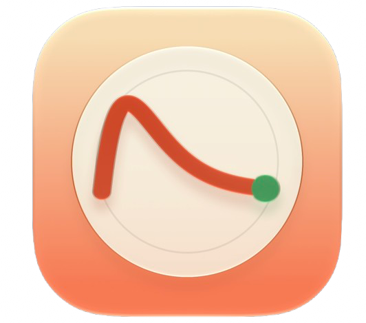
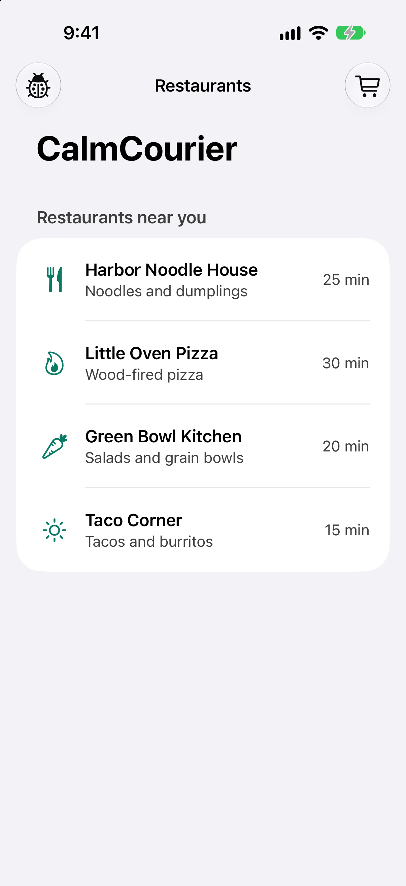
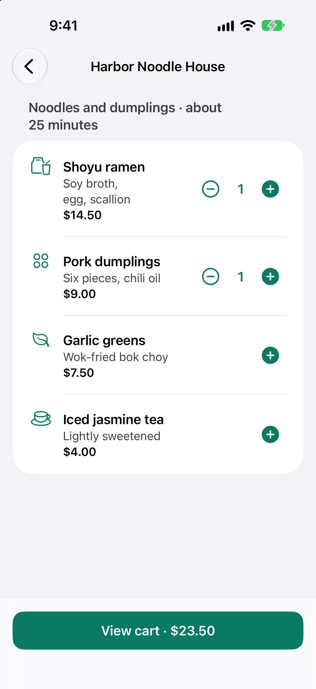
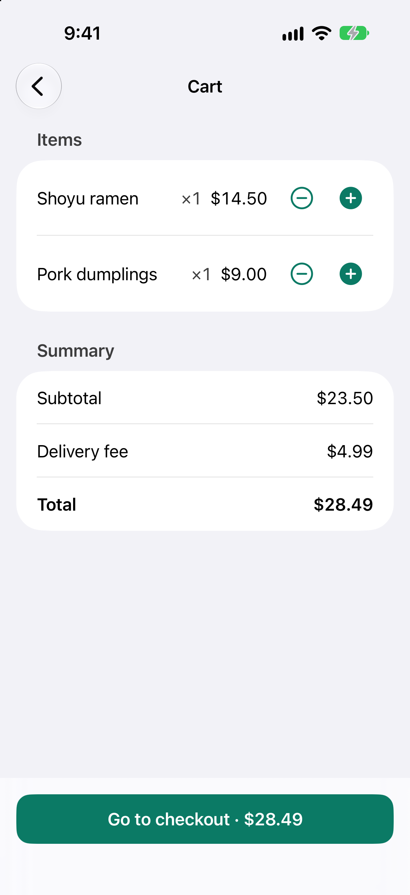
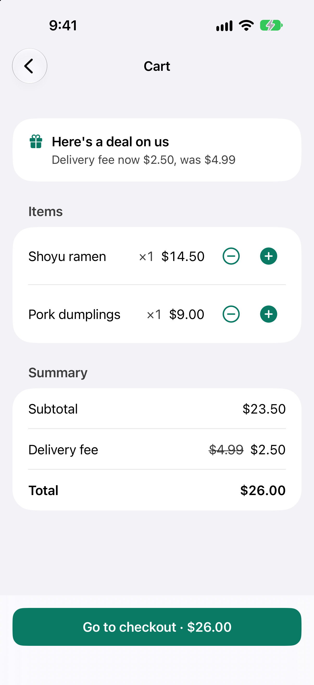
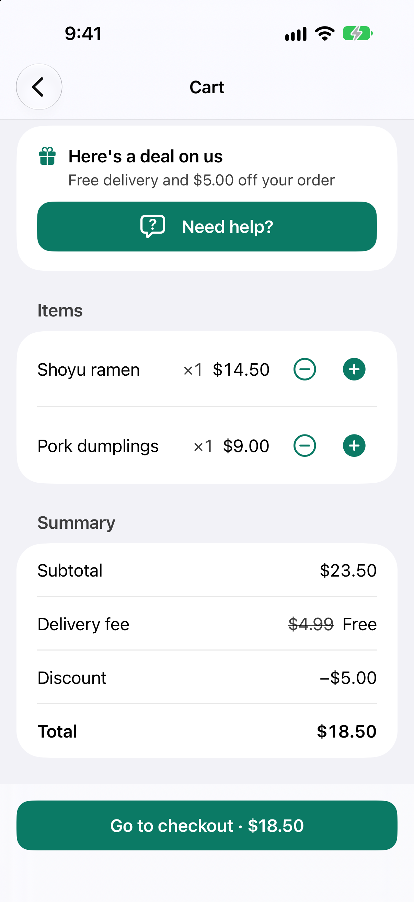
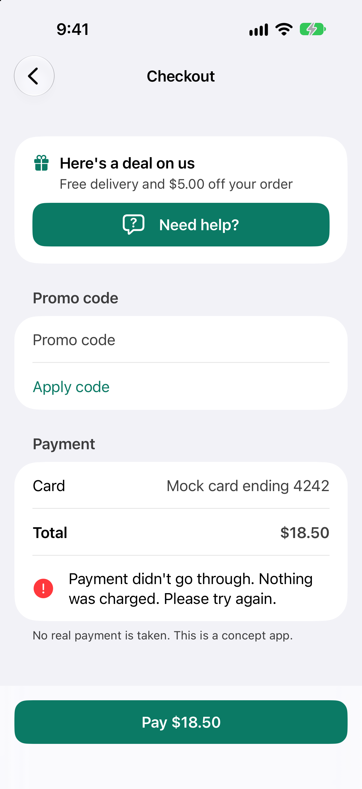
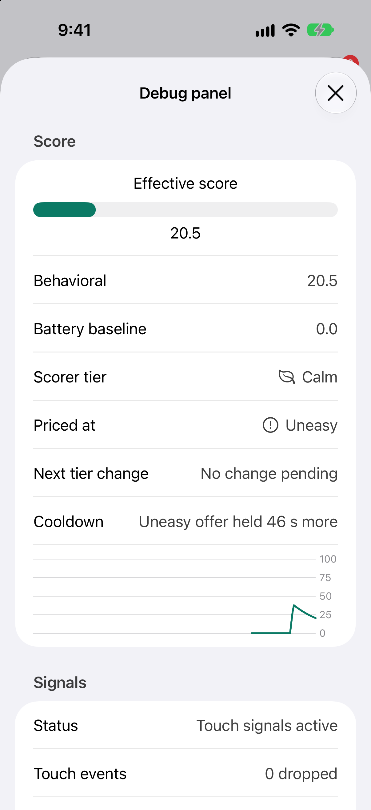
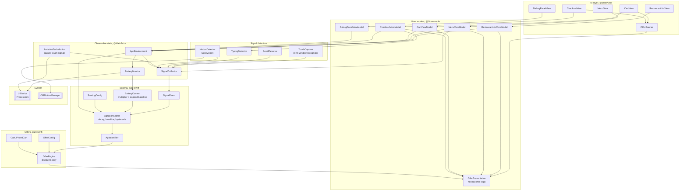
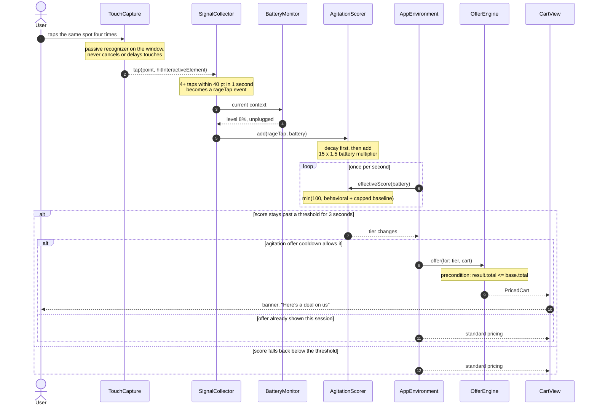

<div align="center">
  
  <h1>CalmCourier</h1>
  <p><strong>A delivery app that notices friction and answers with a better deal, never a worse one.</strong></p>
</div>

CalmCourier is a SwiftUI learning project for iOS 27 that explores whether a food delivery app could infer frustration or urgency from how someone uses it, and respond with a lower delivery fee or a discount. It watches touch, scroll, typing, motion, and battery signals, folds them into a rolling agitation score, and maps that score to an offer tier. No backend, no account, no payments. Everything runs in memory on device.

> ## ⚠️ Concept Only. Not for Release.
>
> This is a **concept model built for learning**. It is **not** intended to be released, distributed, submitted to the App Store, shared via TestFlight, or used with real customers, real orders, or real pricing. Inferring a person's emotional or situational state in order to adjust prices raises serious ethical, legal, and privacy questions that this project deliberately does not try to resolve.

## Screenshots

Captured on an iPhone 18 Pro Simulator running iOS 27.2, with the debug panel's battery override set to 80%, since Simulator reports no real battery level. Offers were triggered with injected events from the debug panel.

| Restaurant list | Menu | Cart, Calm |
| :---: | :---: | :---: |
|  |  |  |
| **Cart, Uneasy** | **Cart, Frustrated** | **Checkout failure** |
|  |  |  |
| **Debug panel** | | |
|  | | |

## Key Features

- **Behavioral signals**: rage taps, dead taps, rapid scroll reversals, high-velocity flicks, backspace bursts, checkout failures, back-and-forth navigation, and device shakes.
- **Battery context**: level, charging state, and Low Power Mode, read through `UIDevice` and `ProcessInfo`. A low battery amplifies behavior that is already happening and adds a small capped baseline. It can never change the offer tier on its own.
- **Rolling agitation score**: 0 to 100, with exponential decay, a personal baseline learned in the first ~30 seconds, and hysteresis so offers do not flicker.
- **Three offer tiers**: Calm, Uneasy, and Frustrated, mapping to standard pricing, a halved delivery fee, and free delivery plus a flat discount and a support prompt.
- **Discounts only**: a hard floor enforced by a `precondition` and a unit test: no code path may raise a price because of agitation, urgency, or battery level.
- **Debug panel**: live score, tier, battery context, event log with point contributions, tunable weights, battery override controls, and synthetic event buttons, so every decision is explainable.
- **Works without real frustration**: injected events and a battery override make the whole signal, score, and offer loop developable and testable on Simulator.
- **User opt-out**: a visible setting turns adaptive offers off, which also stops battery monitoring.
- **On-device only**: nothing is persisted, logged, or sent anywhere.
- **Accessible**: VoiceOver labels on every control, text that scales up to the largest accessibility sizes, an accent color with at least 4.5:1 contrast in light and dark mode, spoken announcements for offers and checkout errors, and Reduce Motion support. Accessibility audits run in the UI tests.

## Technologies

- Swift 6
- SwiftUI
- UIKit, for window-level touch capture and battery state
- CoreMotion, for shake detection
- Observation framework
- Swift Testing framework (unit and scenario tests)
- First-party Apple frameworks only, no third-party dependencies
- iOS 27.2 minimum OS target

## Architecture

The app follows **MVVM**. Views are SwiftUI only, each screen has an `@Observable` view model that turns shared state into display-ready text and accessibility labels, and the models underneath are plain Swift. Signal collection, scoring, and offer logic are separate stages. Scoring and offers have no UI dependencies, so they are easy to unit test. Battery state enters the scorer as **context**, not as an event.



And the path a burst of frustrated taps takes, from finger to discount:



| Layer | Responsibility | Key types |
| :--- | :--- | :--- |
| **Models** | Value types for the mock catalog and priced carts | `Cart`, `PricedCart`, `Restaurant`, `MenuItem` |
| **Signals** | Turn raw input into discrete events | `SignalCollector`, `TouchCapture`, `ScrollDetector`, `TypingDetector`, `MotionDetector` |
| **Context** | Device state that shapes how events are weighted, or whether touch events count at all | `BatteryMonitor`, `BatteryContext`, `AssistiveTechMonitor` |
| **Scoring** | Weights, decay, baseline, hysteresis, tiers | `AgitationScorer`, `SignalEvent`, `AgitationTier`, `ScoringConfig` |
| **Offers** | Map a tier to a price, discounts only | `OfferEngine`, `OfferConfig` |
| **State** | Wires everything together and ticks the scorer once per second | `AppEnvironment` |
| **View models** | One per screen: display-ready text, accessibility labels, and user intents | `RestaurantListViewModel`, `MenuViewModel`, `CartViewModel`, `CheckoutViewModel`, `DebugPanelViewModel`, `OfferPresentation` |
| **Views** | SwiftUI screens, the offer banner, and the debug panel. No business logic | `AppRootView`, `RestaurantListView`, `MenuView`, `CartView`, `CheckoutView`, `OfferBanner`, `DebugPanelView` |

### Focus areas

1. **A price floor that cannot be argued with**

   The price a calm user with a full battery sees is the maximum any user sees. `OfferEngine` ends with a `precondition(result.total <= base.total)`, and a property-style test runs it over many random carts, scores, and battery states. Agitation, low battery, or both can unlock a discount. They never unlock a surcharge.

2. **Battery as context, not a trigger**

   Battery state does two things: it multiplies behavioral events (1.25x at 20% or below, 1.5x at 10% or below, while unplugged), and it adds a baseline. That baseline is capped at 15, below the Uneasy threshold of 30, so a low battery alone can never change the tier. Charging or an unknown level contributes nothing.

3. **Scoring that can be explained**

   Every point in the score traces to a logged event. Weights live in `ScoringConfig` and can be tuned from the debug panel. Decay is exponential with a 20 second half-life, and a tier change only applies after the score has stayed past a threshold for 3 seconds.

4. **Pure logic away from the UI**

   `AgitationScorer`, `BatteryContext`, and `OfferEngine` import nothing from SwiftUI or UIKit. Time is passed into `decay(to:)` as a parameter in tests, so decay and hysteresis are deterministic without a clock.

5. **Everything observable, because nothing here is trustworthy by itself**

   Each signal is weak: fast scrolling can be skimming, repeated taps can be a laggy device, and a low battery can mean nothing at all. The debug panel exists so a given offer can always be traced to the events that caused it, and so a bug is distinguishable from real behavior.

## Signals

### Behavioral signals

| Signal | How it is detected | Default weight |
| :--- | :--- | :---: |
| Rage tap | 4+ taps within 40 pt in 1 second | +15 |
| Dead tap | Tap on a non-interactive element | +4 |
| Rapid scroll reversal | 3+ direction changes in 2 seconds | +8 |
| High-velocity flick, no tap after | Velocity above personal baseline by 2x, no tap within 3 seconds | +5 |
| Backspace burst | 5+ deletions in 2 seconds | +6 |
| Checkout failure | Payment or promo error shown | +12 |
| Back-and-forth navigation | Same two screens swapped 3+ times in 10 seconds | +10 |
| Device shake | Accelerometer magnitude spike (CoreMotion) | +10 |

### Context signals (battery)

| Condition | Baseline points | Event multiplier |
| :--- | :---: | :---: |
| Charging, full, or level unknown | 0 | 1.0x |
| Battery 20% or below, not charging | +10 | 1.25x |
| Battery 10% or below, not charging | +15 | 1.5x |
| Low Power Mode on | +5 | no change |

Baseline points from all battery conditions are capped at 15. All weights live in `Config/ScoringConfig.swift`.

## Offer tiers

| Tier | Effective score | Behavior |
| :--- | :---: | :--- |
| Calm | 0 to 29 | Standard pricing, standard deals |
| Uneasy | 30 to 59 | Delivery fee reduced by 50% on the current cart |
| Frustrated | 60 to 100 | Free delivery, a flat cart discount, and a "Need help?" support prompt |

All amounts are mock values in `Config/OfferConfig.swift`.

1. Offers can only reduce cost relative to the calm baseline.
2. At most one agitation offer per session (cooldown), so deliberately rage-tapping or draining the battery for coupons is not rewarded repeatedly.
3. An offer stays for at least 60 seconds once it appears or escalates, even if the score decays back to Calm sooner, so a deal never vanishes while someone is still looking at it. It can escalate from Uneasy to Frustrated during that time, but never shrinks. The hold lives in `Config/OfferConfig.swift`.
4. Offers use a neutral label such as "Here's a deal on us", never "We noticed you're upset" or "We noticed your battery is low".
5. A visible setting turns adaptive offers off, which also stops battery monitoring.

## Testing the signals without being frustrated

You do not need to rage-tap your phone to work on this.

**1. The debug panel injects events**

Tap the ladybug button in the toolbar, triple-tap the app title, or shake with the debug toggle on, to open `DebugPanelView`. Buttons inject synthetic rage taps, failed checkouts, and shakes through the same path a real signal takes.

**2. The battery override replaces the hardware**

Simulator has no real battery, and `UIDevice.batteryLevel` returns `-1`. `BatteryMonitor` exposes an override that the panel drives with a level slider, a charging toggle, and a Low Power Mode toggle.

Treat `-1` as unknown, not empty. `batteryLevel` is reported in coarse steps of roughly 5%, and a low battery on a charger is not urgent.

**3. Use a real device for the rest**

Shake detection needs a physical iPhone, and real touch timing only shows up on hardware. Everything above the signal detectors is exercised without it.

### Capturing signals

**Touch.** SwiftUI has no app-wide touch observer, so a passive gesture recognizer is attached to the key window. It must not cancel or delay touches, and it recognizes simultaneously with every other gesture.

Dead-tap detection is approximate because many tappable SwiftUI views are not `UIControl`s. Tag interactive views with `.accessibilityIdentifier` or keep a registry of tappable frames.

**Scroll.** Use real timestamps rather than frame counts, since ProMotion displays refresh at variable rates, and smooth velocity with an exponential moving average. `.onScrollGeometryChange(for:of:action:)` reports content offset changes, timestamped with `CACurrentMediaTime()`.

**Typing.** Observe the text field with `.onChange(of:)` and track deletions by comparing string lengths between changes.

**Motion.** `CMMotionManager` samples the accelerometer at 30 Hz, and an acceleration magnitude above roughly 2.2 g is recorded as a shake.

## Requirements

- Xcode with the iOS 27 SDK, iOS 27 deployment target
- A physical iPhone is strongly recommended. Simulator covers touch, scroll, and typing signals, but shake needs real hardware and battery needs the debug override
- No Apple Developer capabilities, entitlements, or paid account. Local builds to your own device are enough
- No third-party dependencies

## Getting started

1. Clone the repo and open `CalmCourier.xcodeproj`
2. Build to Simulator or a physical iPhone running iOS 27
3. Browse two restaurants and add items to the cart
4. Tap the ladybug button (or triple-tap the app title) to open the debug panel
5. Set the battery override, inject some events, and watch the tier and cart change

## Debug panel

Tap the ladybug button in the toolbar, triple-tap the app title, or shake with the debug toggle on, to open `DebugPanelView`. The toolbar button is the path that works with VoiceOver, Switch Control, and Voice Control. It shows:

- Live effective score with a gauge and history sparkline, split into behavioral score and battery baseline
- Current tier and time until the next tier change is allowed
- Current battery context: level, charging state, Low Power Mode, and the resulting multiplier
- A log of recent signal events and their point contributions after the battery multiplier
- Sliders for each signal weight and for the half-life
- Battery override controls: a level slider, a charging toggle, and a Low Power Mode toggle
- Buttons to inject synthetic events (rage tap, failed checkout, shake)
- A toggle for "Adaptive offers enabled"
- A reset button that clears score, baseline, and offer cooldown

## Data and storage

There is none. Behavioral and battery signals, the score, and the offer cooldown live in memory and are discarded when the app closes. Nothing is written to disk, logged, or sent anywhere. The mock restaurants and menus ship as a bundled `restaurants.json`.

## Testing

Unit and scenario tests use [Swift Testing](https://developer.apple.com/documentation/testing/), organised by feature.

| Suite | Covers |
| :--- | :--- |
| `AgitationScorerTests` | Expected points per event, decay halving after one half-life, clamping to 0 and 100, hysteresis preventing tier flicker |
| `BatteryContextTests` | Multiplier and baseline for every level, charging, and Low Power Mode combination; baseline never above 15; charging or unknown level contributes nothing |
| `OfferEngineTests` | Total never above baseline for any tier, cart, score, or battery state (property-style over many random inputs); cooldown blocking a second agitation offer; the 60 second minimum hold and escalation during it |
| `ScenarioTests` | Recorded event sequences and battery states fed through the scorer, asserting the tier reached |
| `SignalDetectorTests` | Rage taps, dead taps, scroll reversals, flicks and the learned baseline, backspace bursts, back-and-forth navigation, and shakes; touch signals dropped while an assistive technology is active |
| `ViewModelTests` | Display text and spoken labels for each screen, offer copy, cooldown, opt-out, checkout failures, and debug injections, on a manual clock |
| `CalmCourierUITests` | Browse-to-checkout flow, an injected offer appearing, and `performAccessibilityAudit()` on every screen |

Scenario coverage:

| Scenario | Battery | Expected tier |
| :--- | :--- | :--- |
| Normal browsing, a few taps and scrolls | 80% | Calm |
| Normal browsing, a few taps and scrolls | 8%, unplugged | Calm (baseline alone stays below Uneasy) |
| Four taps on an unresponsive button | 80% | Calm or Uneasy, near the threshold |
| Same four taps on an unresponsive button | 8%, unplugged | Uneasy (amplified by multiplier and baseline) |
| Same four taps | 8%, charging | Same as the 80% case |
| Failed promo twice, rapid back-and-forth, rage taps | 80% | Frustrated |
| Fast scrolling that ends in an add-to-cart tap | 80% | Calm (flick followed by engagement) |

Manual testing on a real device: deliberately behave "frustrated" and "calm" at different battery levels and compare the debug log against expectations.

## Demo script

1. Launch the app with the debug battery override set to 80%. Browse two restaurants normally. The score stays near zero and the cart shows the standard $4.99 delivery fee.
2. Scroll up and down rapidly without tapping anything. The score climbs and the tier moves to Uneasy. The fee drops to $2.50 with a banner.
3. Reset the session. Set the battery override to 8%, unplugged, and repeat only a mild version of step 2. The same behavior now reaches a higher score because of the multiplier and baseline, while idle browsing alone still stays Calm.
4. Toggle charging on and repeat. The battery effect disappears.
5. Go to checkout and trigger the mock payment failure twice, then tap repeatedly on the pay button. The tier moves to Frustrated, delivery becomes free, a discount appears, and a support prompt shows.
6. Stop interacting for 40 seconds. The behavioral score decays back toward Calm.
7. Open the debug panel and walk through the event log to show exactly why each change happened.

## Ethics and guardrails

Adjusting prices from inferred emotional or situational state is sensitive, even in a learning project. These are built-in constraints, not afterthoughts:

- **Concept only.** This project must not be released, distributed, or used with real customers or real pricing.
- **Discounts only.** No code path may raise a price because of agitation, urgency, or battery level. A frustrated user or a user with 5% battery must never pay more than a calm user with a full battery.
- **No exploiting vulnerability.** A low battery is exactly the kind of context that could be abused to charge more to someone with less leverage. Using device state to raise prices is an area that has drawn public scrutiny, and this project deliberately goes the other direction. Do not extend it that way.
- **Battery is context, not a trigger.** The baseline is capped so battery alone never changes the offer tier.
- **Transparency.** The UI never claims to know how the user feels or reveals which signals were used, and a setting lets them disable adaptive offers.
- **On-device only.** Nothing is logged to disk or sent anywhere.
- **Proportionate use.** Where possible, the better response to frustration is fixing the cause (slow screens, broken buttons), so use this data to find those problems.

Any real-world version of this idea would need legal and policy review. Dynamic pricing based on behavioral and device inference can raise consumer protection, privacy (GDPR, CCPA), and App Store review questions.

## Repo structure

```
CalmCourier/
├── CalmCourier/
│   ├── App/
│   │   ├── CalmCourierApp.swift
│   │   ├── AppEnvironment.swift         # wires collector, battery, scorer, engine
│   │   ├── AppEnvironment+Preview.swift # preview data and a manual clock (Debug only)
│   │   └── AppRoute.swift
│   ├── Models/
│   │   ├── Restaurant.swift
│   │   ├── MenuItem.swift
│   │   ├── Cart.swift
│   │   ├── PricedCart.swift
│   │   ├── Money.swift                  # Decimal rounding and currency text
│   │   └── CatalogLoader.swift
│   ├── Signals/
│   │   ├── SignalCollector.swift        # @Observable, owns all detectors, gates touch signals
│   │   ├── TouchCapture.swift           # window-level gesture recognizer
│   │   ├── TapPatternDetector.swift     # rage and dead taps
│   │   ├── ScrollDetector.swift         # reversals, flicks, learned baseline
│   │   ├── TypingDetector.swift
│   │   ├── NavigationDetector.swift
│   │   ├── MotionDetector.swift         # CoreMotion shake
│   │   ├── BatteryMonitor.swift         # level, charging, Low Power Mode
│   │   └── AssistiveTechMonitor.swift   # VoiceOver, Switch Control, AssistiveTouch
│   ├── Scoring/
│   │   ├── SignalEvent.swift
│   │   ├── BatteryContext.swift
│   │   ├── AgitationScorer.swift
│   │   └── AgitationTier.swift
│   ├── Offers/
│   │   ├── OfferEngine.swift
│   │   └── OfferCooldown.swift
│   ├── ViewModels/
│   │   ├── RestaurantListViewModel.swift
│   │   ├── MenuViewModel.swift
│   │   ├── CartViewModel.swift
│   │   ├── CheckoutViewModel.swift
│   │   ├── DebugPanelViewModel.swift
│   │   └── OfferPresentation.swift      # neutral offer copy
│   ├── Views/
│   │   ├── AppRootView.swift            # navigation, debug sheet, announcements
│   │   ├── RestaurantListView.swift
│   │   ├── MenuView.swift
│   │   ├── CartView.swift
│   │   ├── CheckoutView.swift
│   │   ├── OfferBanner.swift
│   │   ├── DebugPanelView.swift
│   │   ├── InteractiveRegion.swift      # frame registry for dead-tap detection
│   │   └── Styles.swift                 # accessible colors, button style, adaptive layout
│   ├── Config/
│   │   ├── ScoringConfig.swift
│   │   └── OfferConfig.swift
│   └── MockData/
│       └── restaurants.json
├── CalmCourierTests/
│   ├── AgitationScorerTests.swift
│   ├── BatteryContextTests.swift
│   ├── OfferEngineTests.swift
│   ├── ScenarioTests.swift
│   ├── SignalDetectorTests.swift
│   ├── ViewModelTests.swift
│   └── TestSupport.swift
├── CalmCourierUITests/
│   └── CalmCourierUITests.swift         # flows and accessibility audits
├── Screenshots/
└── README.md
```

## Trade-offs and decisions

- **Weak signals, accepted.** Fast scrolling can mean skimming, repeated taps can mean a laggy device, and low battery can mean nothing at all. False positives are expected, which is part of why the only possible response is a discount.
- **Battery is a crude proxy for hurry.** Many people run low on battery routinely and are not rushed. Coarse level reporting and varying charging habits make it noisier still. That is why it only amplifies and never triggers.
- **Gameable.** Users who learn the pattern can trigger offers on purpose. The one-offer-per-session cooldown mitigates this but does not solve it.
- **Heuristic weights.** The defaults are educated guesses, not tuned on real data. They live in one config file and the debug panel so they are easy to change.
- **Rule-based, not learned.** A hand-written scorer is transparent and testable. A model would be harder to explain and would need data this project does not have.
- **Dead-tap accuracy.** SwiftUI hit testing is imprecise without a registry of interactive frames, so dead taps are approximate.
- **Simulator gaps.** No real motion or battery data, and touch timing differs from a device. The battery override and event injection exist to cover this.
- **Assistive technology pauses touch signals.** VoiceOver, Switch Control, and AssistiveTouch produce tap and scroll patterns that look like frustration, so rage taps, dead taps, scroll reversals, and flicks are ignored while any of them is running. Checkout failures, navigation, typing, and shake still count. Voice Control has no public detection API, so it can't be paused automatically. People using it can turn adaptive offers off instead.
- **No persistence of behavioral data.** Keeping signals in memory means there is no personal baseline across launches, and also nothing to leak.

## License

Released under the [MIT License](LICENSE). © 2026 SarahUniverse
